# Melly-Mascot

**Melly** ist ein Pixel-Maskottchen, das komplett aus Code besteht: ein Creme-Blob im Einreiher. Ein Nebenprojekt, in dem ich ausprobiere, wie weit man Figur, Animationen und Tooling agentisch mit KI-Unterstützung bauen kann.

<p align="center">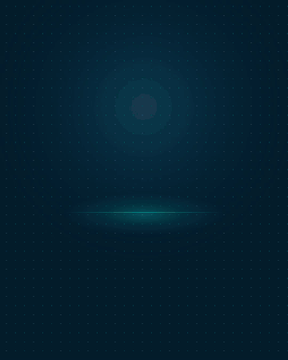</p>

<p align="center"><sub>Intro „Meet Melly“ · <a href="dist/video/melly-intro.mp4">MP4 in voller Auflösung</a> (4:5, 1080×1350)</sub></p>

## Was drin steckt
- **Modell und Posen als Code** (`src/`): Raster, Paletten, Bausteine und alle Animationen als JavaScript. Keine Handzeichnungen, jede Pose ist reproduzierbar.
- **Renderer und Export** (`tools/`): GIF, PNG und Sprite-Sheets in 6 Anzug-Kombis und mit Outfits, dazu Kontaktbögen zur Selbstprüfung.
- **Galerie** (`index.html`): lokale Übersicht mit Kombi-Umschalter.
- **Intro-Video** (`video/`): ein durchgehender 4:5-Clip (für LinkedIn oder eine Maskottchen-Präsentation), der Melly und alle 6 Anzug-Kombis am Stück vorstellt – aus den echten Posen-Frames über Chrome-headless und ffmpeg zu MP4.
- **Claude-Code-Skill** (`.claude/skills/melly/`): ein Agent baut damit neue Posen und Outfits nach festen Regeln (`BRAND.md`).
- **Claude-Code-Mod** (`mod/melly-mascot/`): Melly lebt über der Prompt-Leiste und reagiert auf Claude, Tippen und Inaktivität.

## Ausprobieren
```bash
npm install
npm run gallery   # Galerie auf http://localhost:8777
npm run video     # Intro-Video → dist/video/melly-intro-4x5.mp4 (braucht Chrome + ffmpeg)
```

> **Source available, nicht Open Source.** © 2026 Marlon Etzel, alle Rechte vorbehalten. Der Code und die Figur „Melly“ sind nur zur Ansicht veröffentlicht; Kopieren, Weiterverwenden oder KI-Training ohne schriftliche Genehmigung ist nicht gestattet. Siehe [LICENSE](LICENSE).

<!-- KATALOG:START -->
<!-- Automatisch erzeugt mit `npm run catalog` – nicht von Hand bearbeiten. -->

<p align="center"></p>

**Melly** ist ein Pixel-Maskottchen als Code: Creme-Blob im Einreiher, Name aus dem Kürzel MEL. 73 Posen · 6 Anzug-Kombis · 8 Outfit(s) · 4 Accessoires · 8 Ansichten · 10 Gesichtsausdrücke. Asset-Stand: `v1`.

## Katalog
Komplette Figur-Referenz – zum Aufklappen.

<details>
<summary><b>Anzug-Kombis</b> · 6</summary>

Krawatte und Einstecktuch haben immer die Akzentfarbe.

<table>
<tr><td align="center" valign="top">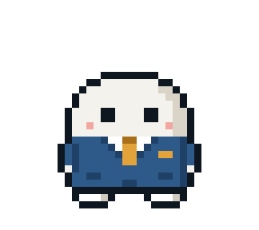<br><sub>Mittelblau<br>Messing</sub></td><td align="center" valign="top">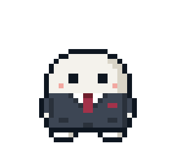<br><sub>Anthrazit<br>Bordeaux</sub></td><td align="center" valign="top">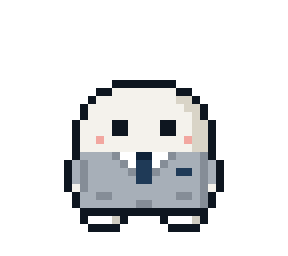<br><sub>Hellgrau<br>Navy</sub></td><td align="center" valign="top">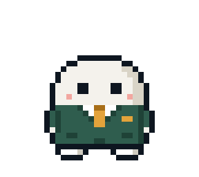<br><sub>Dunkelgrün<br>Messing</sub></td><td align="center" valign="top">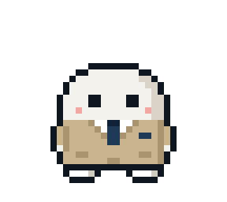<br><sub>Sand<br>Navy</sub></td><td align="center" valign="top">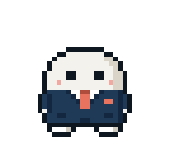<br><sub>Navy<br>Koralle</sub></td></tr>
</table>
</details>

<details>
<summary><b>Outfits</b> · 8</summary>

Kostüme, die über jede passende Pose gelegt werden (eigene Farben + Accessoires). Ordner: `dist/v1/outfit-<id>/`.

**Weihnachtsmann** (`weihnachten`) — Roter Anzug mit Gürtel und Pelzsaum, Weihnachtsmütze mit Bommel. Krawatte/Einstecktuch bleiben Messing. Läuft mit 42 Posen.

<table>
<tr><td align="center" valign="top">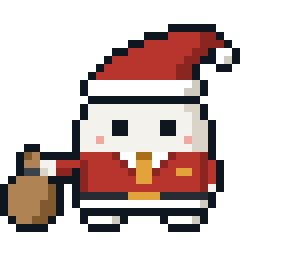<br><b>Weihnachtsmann</b><br><code>weihnachtsmann</code></td><td align="center" valign="top">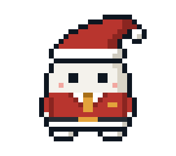<br><b>Winken</b><br><code>winken</code></td><td align="center" valign="top">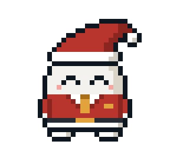<br><b>Jubeln</b><br><code>jubeln</code></td></tr>
<tr><td align="center" valign="top"><br><b>Daumen hoch</b><br><code>daumen-hoch</code></td><td align="center" valign="top">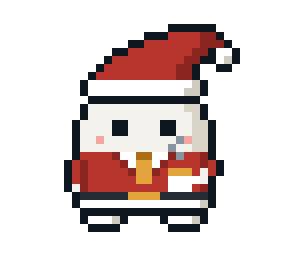<br><b>Kaffee</b><br><code>kaffee</code></td><td align="center" valign="top">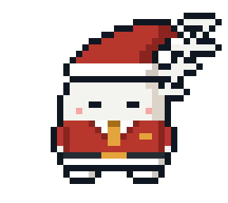<br><b>Schlafen</b><br><code>schlafen</code></td></tr>
</table>

**Bauhelm** (`bauhelm`) — Gelber Bauarbeiterhelm mit Grat, Kopfband und zweistufigem Schirm (hinten mit Nackenband), in allen Ansichten; zum Hinlegen nimmt Melly ihn ab und stellt ihn neben sich. Anzug bleibt in der Kombi – Melly als Bauleiter. Läuft mit 68 Posen.

<table>
<tr><td align="center" valign="top">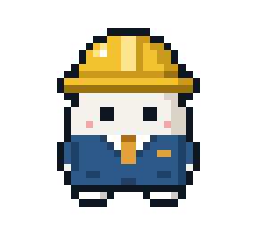<br><b>Winken</b><br><code>winken</code></td><td align="center" valign="top"><br><b>Jubeln</b><br><code>jubeln</code></td><td align="center" valign="top">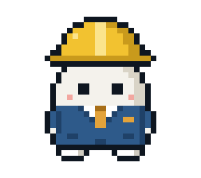<br><b>Daumen hoch</b><br><code>daumen-hoch</code></td></tr>
<tr><td align="center" valign="top">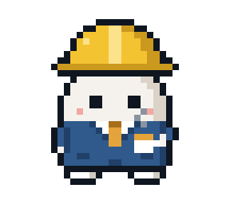<br><b>Kaffee</b><br><code>kaffee</code></td><td align="center" valign="top">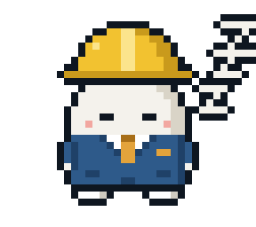<br><b>Schlafen</b><br><code>schlafen</code></td></tr>
</table>

**Angler** (`angler`) — Fischerhut mit Fliege, Wathose über dem Anzug, Gummistiefel, Angel mit Tabelle (liegt am Boden, wenn er den Arm braucht). Lakehouse-Bezug. Läuft mit 41 Posen.

<table>
<tr><td align="center" valign="top">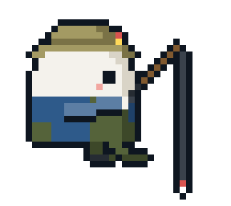<br><b>Angeln auf der Kante</b><br><code>angeln</code></td><td align="center" valign="top">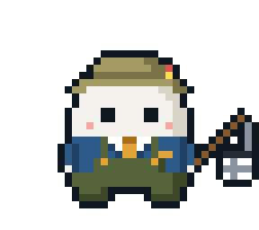<br><b>Winken</b><br><code>winken</code></td><td align="center" valign="top"><br><b>Jubeln</b><br><code>jubeln</code></td></tr>
<tr><td align="center" valign="top"><br><b>Daumen hoch</b><br><code>daumen-hoch</code></td><td align="center" valign="top">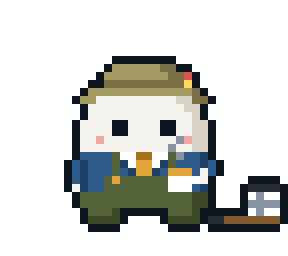<br><b>Kaffee</b><br><code>kaffee</code></td><td align="center" valign="top">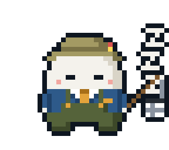<br><b>Schlafen</b><br><code>schlafen</code></td></tr>
</table>

**Agent** (`agent`) — Fast schwarzer Anzug, dunkle Krawatte, Knopf im Ohr mit Spiralkabel. Wortspiel AI-Agent. Läuft mit 37 Posen.

<table>
<tr><td align="center" valign="top">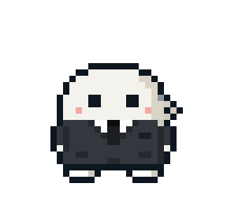<br><b>Winken</b><br><code>winken</code></td><td align="center" valign="top"><br><b>Jubeln</b><br><code>jubeln</code></td><td align="center" valign="top"><br><b>Daumen hoch</b><br><code>daumen-hoch</code></td></tr>
<tr><td align="center" valign="top">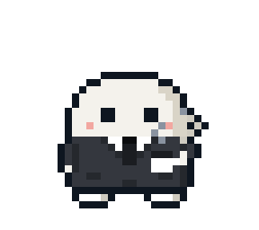<br><b>Kaffee</b><br><code>kaffee</code></td><td align="center" valign="top">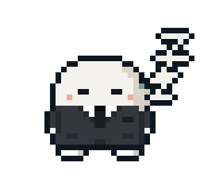<br><b>Schlafen</b><br><code>schlafen</code></td></tr>
</table>

**Lagerist** (`lagerist`) — Offene orange Warnweste mit Reflexstreifen über dem Anzug, gelber Bauhelm. Warehouse-Bezug. Läuft mit 43 Posen.

<table>
<tr><td align="center" valign="top">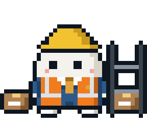<br><b>Kiste ins Regal</b><br><code>einsortieren</code></td><td align="center" valign="top">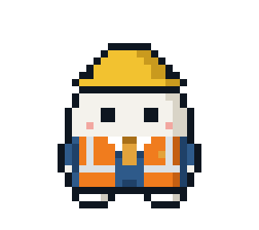<br><b>Winken</b><br><code>winken</code></td><td align="center" valign="top"><br><b>Jubeln</b><br><code>jubeln</code></td></tr>
<tr><td align="center" valign="top"><br><b>Daumen hoch</b><br><code>daumen-hoch</code></td><td align="center" valign="top">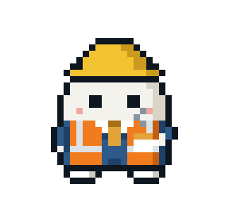<br><b>Kaffee</b><br><code>kaffee</code></td><td align="center" valign="top">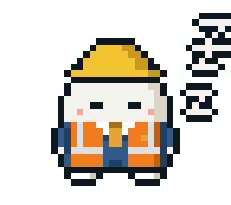<br><b>Schlafen</b><br><code>schlafen</code></td></tr>
</table>

**Zauberer** (`zauberer`) — Spitzer Hut mit Sternen, violette Robe mit Messing-Sternen. Läuft mit 38 Posen.

<table>
<tr><td align="center" valign="top">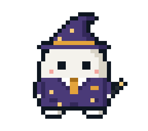<br><b>Dashboard herbeizaubern</b><br><code>zaubern</code></td><td align="center" valign="top">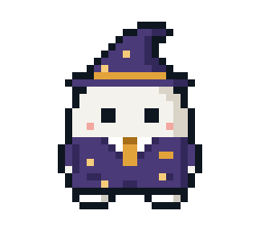<br><b>Winken</b><br><code>winken</code></td><td align="center" valign="top"><br><b>Jubeln</b><br><code>jubeln</code></td></tr>
<tr><td align="center" valign="top"><br><b>Daumen hoch</b><br><code>daumen-hoch</code></td><td align="center" valign="top">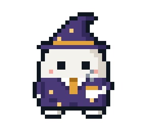<br><b>Kaffee</b><br><code>kaffee</code></td><td align="center" valign="top">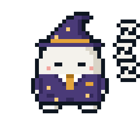<br><b>Schlafen</b><br><code>schlafen</code></td></tr>
</table>

**Koch** (`koch`) — Kochmütze mit Falten, graublaue Schürze. Läuft mit 42 Posen.

<table>
<tr><td align="center" valign="top">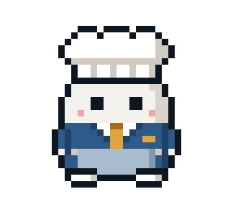<br><b>Winken</b><br><code>winken</code></td><td align="center" valign="top"><br><b>Jubeln</b><br><code>jubeln</code></td><td align="center" valign="top"><br><b>Daumen hoch</b><br><code>daumen-hoch</code></td></tr>
<tr><td align="center" valign="top">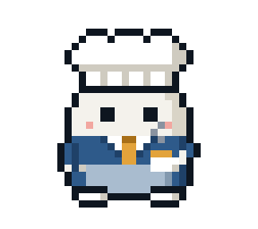<br><b>Kaffee</b><br><code>kaffee</code></td><td align="center" valign="top">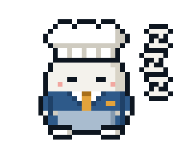<br><b>Schlafen</b><br><code>schlafen</code></td></tr>
</table>

**Cowboy** (`cowboy`) — Cowboyhut mit Delle und hochgebogener Krempe. Läuft mit 37 Posen.

<table>
<tr><td align="center" valign="top">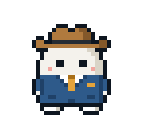<br><b>Winken</b><br><code>winken</code></td><td align="center" valign="top"><br><b>Jubeln</b><br><code>jubeln</code></td><td align="center" valign="top"><br><b>Daumen hoch</b><br><code>daumen-hoch</code></td></tr>
<tr><td align="center" valign="top">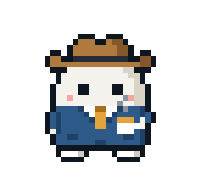<br><b>Kaffee</b><br><code>kaffee</code></td><td align="center" valign="top">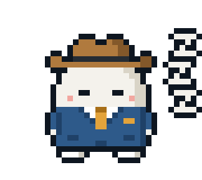<br><b>Schlafen</b><br><code>schlafen</code></td></tr>
</table>
</details>

<details>
<summary><b>Accessoires</b> · 4</summary>

Kleine Extras zum An- und Abschalten, kombinierbar mit jeder Kombi und jedem Outfit. Ordner: `dist/v1/accessoire-<id>/` (Mittelblau).

**Brille** (`brille`) — Klassische schwarze Brille mit runden Gläsern. Läuft mit 36 Posen.

<table>
<tr><td align="center" valign="top"><br><b>Winken</b><br><code>winken</code></td><td align="center" valign="top"><br><b>Kaffee</b><br><code>kaffee</code></td></tr>
</table>

**Nerd-Brille** (`nerdbrille`) — Schwarze Brille mit Tape am Steg. Läuft mit 36 Posen.

<table>
<tr><td align="center" valign="top">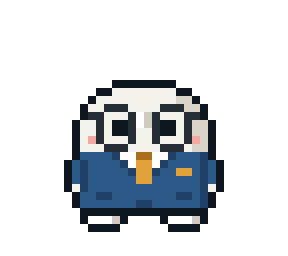<br><b>Winken</b><br><code>winken</code></td><td align="center" valign="top">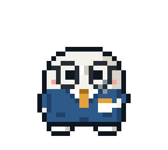<br><b>Kaffee</b><br><code>kaffee</code></td></tr>
</table>

**Kopfhörer** (`kopfhoerer`) — Over-Ear-Kopfhörer, Fokus-Modus. Läuft mit 37 Posen.

<table>
<tr><td align="center" valign="top">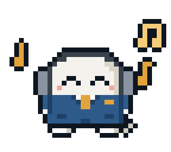<br><b>Musik hören</b><br><code>musik</code></td><td align="center" valign="top">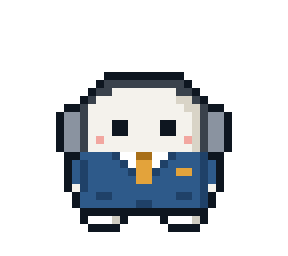<br><b>Winken</b><br><code>winken</code></td><td align="center" valign="top">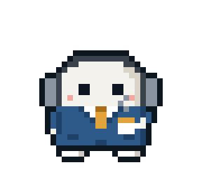<br><b>Kaffee</b><br><code>kaffee</code></td></tr>
</table>

**Konferenz-Badge** (`badge`) — Namensschild am Band in Event-Farbe, für Konferenz- und Meetup-Posts. Läuft mit 36 Posen.

<table>
<tr><td align="center" valign="top">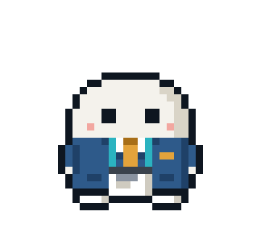<br><b>Winken</b><br><code>winken</code></td><td align="center" valign="top">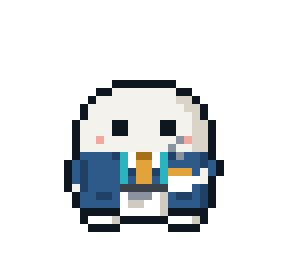<br><b>Kaffee</b><br><code>kaffee</code></td></tr>
</table>
</details>

<details>
<summary><b>Ansichten</b> · 8</summary>

<table>
<tr><td align="center" valign="top"><br><sub>vorne</sub></td><td align="center" valign="top">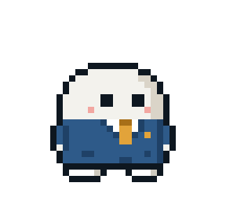<br><sub>3/4 rechts</sub></td><td align="center" valign="top">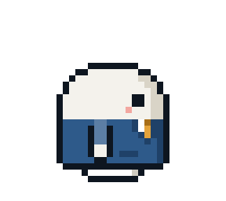<br><sub>Profil rechts</sub></td><td align="center" valign="top">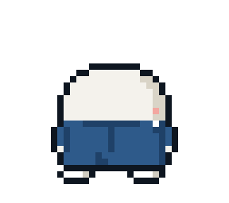<br><sub>3/4 hinten rechts</sub></td><td align="center" valign="top">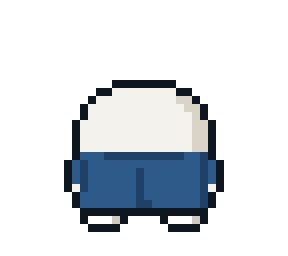<br><sub>hinten</sub></td><td align="center" valign="top">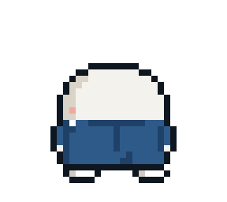<br><sub>3/4 hinten links</sub></td><td align="center" valign="top">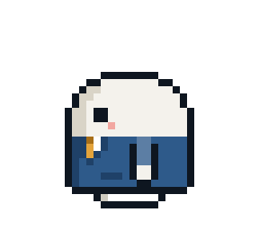<br><sub>Profil links</sub></td><td align="center" valign="top"><br><sub>3/4 links</sub></td></tr>
</table>
</details>

<details>
<summary><b>Mimik</b> · 10</summary>

<table>
<tr><td align="center" valign="top"><br><sub>neutral</sub></td><td align="center" valign="top"><br><sub>fröhlich</sub></td><td align="center" valign="top"><br><sub>zwinkern</sub></td><td align="center" valign="top"><br><sub>„Zeig mal.“</sub></td><td align="center" valign="top"><br><sub>überrascht</sub></td></tr>
<tr><td align="center" valign="top"><br><sub>konzentriert</sub></td><td align="center" valign="top"><br><sub>„Fast.“</sub></td><td align="center" valign="top"><br><sub>schläfrig</sub></td><td align="center" valign="top"><br><sub>begeistert</sub></td><td align="center" valign="top"><br><sub>sauer</sub></td></tr>
</table>
</details>

<details>
<summary><b>Posen &amp; Animationen</b> · 73</summary>

Alle als animiertes GIF (transparent), Standbild-PNG und Sprite-Sheet in jeder Kombi. Gezeigt: Mittelblau · Messing.

#### Bewegung
<table>
<tr><td align="center" valign="top"><br><b>Idle</b><br><code>idle</code><br><sub>Blinzelt unregelmäßig, schaut sich kurz um. Körper bleibt ruhig.</sub></td><td align="center" valign="top"><br><b>Umschauen</b><br><code>umschauen</code><br><sub>Dreht sich in die 3/4-Ansicht nach links und rechts, blinzelt dabei.</sub></td><td align="center" valign="top"><br><b>Drehung 360°</b><br><code>drehung</code><br><sub>vorne → 3/4 → Profil → hinten → zurück, kurzer Halt vorne.</sub></td></tr>
<tr><td align="center" valign="top"><br><b>Laufen (Profil)</b><br><code>laufen</code><br><sub>Lauf-Zyklus auf der Stelle in 8 Phasen: Füße mit halbem Schritt dazwischen, Arm pendelt gegenläufig im Bogen, Körper wippt beim Passieren.</sub></td><td align="center" valign="top"><br><b>Reinlaufen & Hallo</b><br><code>reinlaufen-hallo</code><br><sub>Läuft von links ins Bild, dreht sich über 3/4 zur Kamera und winkt.</sub></td><td align="center" valign="top"><br><b>Tschüss</b><br><code>tschuess</code><br><sub>Winkt, dreht sich über 3/4 ins Profil und läuft aus dem Bild.</sub></td></tr>
<tr><td align="center" valign="top"><br><b>Winken</b><br><code>winken</code><br><sub>Anheben über Zwischenposition, 3× Pendeln zwischen 45° und 30°, zurück.</sub></td><td align="center" valign="top"><br><b>Jubeln</b><br><code>jubeln</code><br><sub>Holt Schwung (Kopf sinkt ein), Arme schwingen im Bogen hoch, Sprung, Landung mit Nachfedern, Arme pumpen abwechselnd, Funken blinken, Arme schwingen zurück.</sub></td><td align="center" valign="top"><br><b>Blick links</b><br><code>blick-links</code><br><sub>Standbild: schaut nach links (für Cursor-Verfolgung).</sub></td></tr>
<tr><td align="center" valign="top"><br><b>Blick rechts</b><br><code>blick-rechts</code><br><sub>Standbild: schaut nach rechts (für Cursor-Verfolgung).</sub></td></tr>
</table>

#### Arbeit
<table>
<tr><td align="center" valign="top"><br><b>Schild hochhalten</b><br><code>schild</code><br><sub>Hebt das Schild, es wippt leicht. Feld bleibt leer für den Post-Titel.</sub></td><td align="center" valign="top"><br><b>Schild mit Platzhalter</b><br><code>schild-platzhalter</code><br><sub>Standbild: Schild mit Platzhalter-Zeilen (für Entwürfe).</sub></td><td align="center" valign="top"><br><b>Checkliste (Profil)</b><br><code>checkliste</code><br><sub>Dreht sich ins Profil, hält das Klemmbrett schräg vor sich, Blick nach unten, hakt ab: grüne Häkchen steigen auf.</sub></td></tr>
<tr><td align="center" valign="top"><br><b>Bug gefunden (Profil)</b><br><code>bug-gefunden</code><br><sub>Prüft das Klemmbrett mit der Lupe, ein Käfer krabbelt unter die Lupe (Glas wird rot), Schreck, rotes Ausrufezeichen.</sub></td><td align="center" valign="top"><br><b>Am Laptop</b><br><code>laptop</code><br><sub>Hält den aufgeklappten Laptop, die Augen lesen Zeile für Zeile von links nach rechts.</sub></td><td align="center" valign="top"><br><b>Handy (LinkedIn)</b><br><code>handy</code><br><sub>Scrollt mit dem Daumen, Blick nach unten, ab und zu ploppt ein Herz (Like) auf.</sub></td></tr>
<tr><td align="center" valign="top"><br><b>Idee</b><br><code>idee</code><br><sub>Grübelt in 3/4 zur Seite gedreht, Glühbirne erscheint, dreht sich zur Kamera, Birne geht an, Zeigefinger hoch.</sub></td><td align="center" valign="top"><br><b>Denken</b><br><code>denken</code><br><sub>Führt die Hand über eine Zwischenposition ans Kinn, Zeigefinger tippt, Blick wandert zur Seite (Braue hoch) und nach oben, Denkpunkte steigen nacheinander auf, Hand geht zurück.</sub></td><td align="center" valign="top"><br><b>Telefonieren</b><br><code>telefonieren</code><br><sub>Hält in 3/4-Ansicht das Handy ans Ohr, hört zu (Blick, Blinzeln), redet in Schüben: Schallwellen laufen nach außen, die freie Hand gestikuliert im Takt, lacht am Ende.</sub></td></tr>
<tr><td align="center" valign="top"><br><b>Laptop rausholen</b><br><code>laptop-raus</code><br><sub>Holt den Laptop mit einem Puff hervor (die Platte wächst aus der Wolke), hält ihn zugeklappt, klappt ihn über Zwischenstufen auf und schaut hinein. Geht nahtlos in „Am Laptop“ über.</sub></td><td align="center" valign="top"><br><b>Laptop wegpacken</b><br><code>laptop-weg</code><br><sub>Klappt den Laptop über Zwischenstufen zu, hält ihn kurz, lässt ihn in einer Wolke schrumpfen und verschwinden und entspannt sich.</sub></td><td align="center" valign="top"><br><b>Dashboard herbeizaubern</b><br><code>zaubern</code><br><sub>Holt mit dem Zauberstab aus, schwingt ihn im Bogen, hebt die andere Hand – Wolke, ein Mini-Dashboard baut sich auf und schwebt über der Hand. Zwinkert, Dashboard verpufft.</sub></td></tr>
<tr><td align="center" valign="top"><br><b>Kiste ins Regal</b><br><code>einsortieren</code><br><sub>Dreht sich zur Kiste, hebt sie auf, trägt sie vor dem Bauch, dreht sich zum Regal und wuchtet sie ins obere Fach. Haken dran.</sub></td></tr>
</table>

#### Reaktion
<table>
<tr><td align="center" valign="top"><br><b>Sauer</b><br><code>sauer</code><br><sub>Brauen ziehen sich zusammen, Kopf läuft rot an, zittert, Dampf steigt auf, kühlt wieder ab.</sub></td><td align="center" valign="top"><br><b>Daumen hoch</b><br><code>daumen-hoch</code><br><sub>Faust kommt hoch, Daumen schnappt nach oben, Zwinkern + Funkeln.</sub></td><td align="center" valign="top"><br><b>Schulterzucken</b><br><code>schulterzucken</code><br><sub>Ellbogen bleiben am Körper, Unterarme klappen seitlich hoch (Handflächen nach oben), Schultern ziehen hoch, Kopf sinkt ein, Brauen flach, lässt los und federt nach.</sub></td></tr>
<tr><td align="center" valign="top"><br><b>Facepalm</b><br><code>facepalm</code><br><sub>Hebt die Hand im Bogen zum Gesicht, legt sie über das Auge, Kopf sinkt, Klatsch-Striche fliegen raus, Hand rutscht etwas herunter und geht über eine Zwischenposition zurück.</sub></td><td align="center" valign="top"><br><b>„Zeig mal.“</b><br><code>zeig-mal</code><br><sub>Rechte Braue geht in zwei Stufen hoch, linkes Auge kneift zusammen, halten.</sub></td><td align="center" valign="top"><br><b>Ungeduldig</b><br><code>ungeduldig</code><br><sub>Hebt den Arm und schaut auf die Uhr, schaut genervt weg, tippt mit dem Fuß (Kopf wippt mit), Schweißtropfen, schaut nochmal auf die Uhr und seufzt.</sub></td></tr>
<tr><td align="center" valign="top"><br><b>Zwinkern</b><br><code>zwinkern</code><br><sub>Linkes Auge zwinkert fröhlich.</sub></td></tr>
</table>

#### Alltag
<table>
<tr><td align="center" valign="top"><br><b>Kaffee</b><br><code>kaffee</code><br><sub>Hält die Tasse, Dampf steigt, hebt sie über eine Zwischenposition vor den Mund und nimmt einen Schluck.</sub></td><td align="center" valign="top"><br><b>Gähnen & Strecken</b><br><code>gaehnen</code><br><sub>Streckt die Arme langsam seitlich im Bogen nach oben, Mund öffnet sich, oben Schultern hoch und kurzes Zittern, Arme sinken zurück, blinzelt müde.</sub></td><td align="center" valign="top"><br><b>Schlafen</b><br><code>schlafen</code><br><sub>Augen zu, Kopf nickt sanft, drei Z steigen versetzt auf und werden größer.</sub></td></tr>
<tr><td align="center" valign="top"><br><b>Gym: Hantel</b><br><code>gym</code><br><sub>Bizeps-Curls in 3/4 mit Kampfblick, beim dritten Mal Schweißtropfen, zum Schluss Blick zur Kamera.</sub></td><td align="center" valign="top"><br><b>Fußball: Jonglieren</b><br><code>fussball</code><br><sub>Jongliert rechts – Mitte – links – Kopfball – zurück. Körper dreht sich zum Ball (3/4), Augen folgen, Ball dreht sich.</sub></td><td align="center" valign="top"><br><b>Kochen: Pfanne</b><br><code>kochen</code><br><sub>Wendet das Ei rechts, gibt die Pfanne an die linke Hand, wendet links, dann verfehlt das Ei die Pfanne und landet auf dem Boden.</sub></td></tr>
<tr><td align="center" valign="top"><br><b>Weihnachtsmann</b><br><code>weihnachtsmann</code><br><sub>Hält den Sack, winkt über Zwischenposition, Bommel wippt mit.</sub></td><td align="center" valign="top"><br><b>Hinlegen</b><br><code>hinlegen</code><br><sub>Steht müde da, geht in die Hocke, kniet sich hin und stützt sich mit der Hand ab, sinkt in drei Neigungsstufen zur Seite, der Kopf legt sich zuletzt ab, Staub, schläft. Endet im Schlaf („Liegt auf dem Boden“).</sub></td><td align="center" valign="top"><br><b>Aufstehen</b><br><code>aufstehen</code><br><sub>Blinzelt aus dem Schlaf, hebt zuerst den Kopf, drückt sich über drei Neigungsstufen auf die Hand hoch, kniet, kommt über die Hocke in den Stand und federt nach.</sub></td></tr>
<tr><td align="center" valign="top"><br><b>Liegt auf dem Boden und schläft</b><br><code>liegen-boden</code><br><sub>Liegt frontal auf der Seite direkt auf dem Boden, Augen zu, Z steigen über dem Kopf auf.</sub></td><td align="center" valign="top"><br><b>Müde</b><br><code>muede</code><br><sub>Steht schläfrig da: Lider halb zu, Kopf sackt leicht ab, blinzelt langsam und gähnt klein.</sub></td><td align="center" valign="top"><br><b>Hinsetzen</b><br><code>hinsetzen</code><br><sub>Holt kurz Schwung, faltet die Beine in der Luft, plumpst mit Staub in den Schneidersitz auf den Boden, federt nach und sitzt.</sub></td></tr>
<tr><td align="center" valign="top"><br><b>Aufstehen aus dem Schneidersitz</b><br><code>aufstehen-sitz</code><br><sub>Sitzt im Schneidersitz am Boden, schaut nach links und rechts, holt Schwung, hüpft auf die Füße und federt nach.</sub></td><td align="center" valign="top"><br><b>Musik hören</b><br><code>musik</code><br><sub>Nickt im Takt, tippt abwechselnd mit den Füßen und schnipst auf 2 und 4. Verschiedene Noten steigen aus den Kopfhörern auf.</sub></td></tr>
</table>

#### Kante
<table>
<tr><td align="center" valign="top"><br><b>Sitzen auf der Kante</b><br><code>sitzen</code><br><sub>Sitzt vorne auf einem Element, Hände auf den Knien, die Beine baumeln gegenläufig, blinzelt und schaut kurz zur Seite.</sub></td><td align="center" valign="top"><br><b>Schlafen auf der Kante</b><br><code>sitzen-schlafen</code><br><sub>Sitzt vorne auf einem Element, Augen zu, Kopf nickt sanft, Beine hängen ruhig, Z steigen auf.</sub></td><td align="center" valign="top"><br><b>Liegt auf der Seite und schläft</b><br><code>liegen-schlafen</code><br><sub>Liegt frontal auf der Seite auf einem Element, Augen zu, Z steigen über dem Kopf auf.</sub></td></tr>
<tr><td align="center" valign="top"><br><b>Schneidersitz</b><br><code>schneidersitz</code><br><sub>Sitzt im Schneidersitz auf einem Element, Hände auf den Knien, blinzelt und schaut sich kurz um.</sub></td><td align="center" valign="top"><br><b>Angeln auf der Kante</b><br><code>angeln</code><br><sub>Sitzt seitlich auf einer Kante, Beine baumeln, Schwimmer wippt. Biss – zieht eine Tabelle aus dem Data Lake, freut sich, holt weit nach hinten aus und wirft in hohem Bogen neu aus.</sub></td></tr>
</table>

#### Zeigen
<table>
<tr><td align="center" valign="top"><br><b>Zeigen · vorne · rechts · hoch</b><br><code>zeigen-vorne-rechts-hoch</code><br><sub>Arm schwingt im Bogen nach rechts hoch und hält – zum Zeigen auf ein Objekt, Blick folgt.</sub></td><td align="center" valign="top"><br><b>Zeigen · vorne · rechts · schräg hoch</b><br><code>zeigen-vorne-rechts-schraeg-hoch</code><br><sub>Arm schwingt im Bogen nach rechts schräg hoch und hält – zum Zeigen auf ein Objekt, Blick folgt.</sub></td><td align="center" valign="top"><br><b>Zeigen · vorne · rechts · waagerecht</b><br><code>zeigen</code><br><sub>Arm schwingt im Bogen nach rechts waagerecht und hält – zum Zeigen auf ein Objekt, Blick folgt.</sub></td></tr>
<tr><td align="center" valign="top"><br><b>Zeigen · vorne · rechts · schräg runter</b><br><code>zeigen-vorne-rechts-schraeg-runter</code><br><sub>Arm schwingt im Bogen nach rechts schräg runter und hält – zum Zeigen auf ein Objekt, Blick folgt.</sub></td><td align="center" valign="top"><br><b>Zeigen · vorne · links · hoch</b><br><code>zeigen-vorne-links-hoch</code><br><sub>Arm schwingt im Bogen nach links hoch und hält – zum Zeigen auf ein Objekt, Blick folgt.</sub></td><td align="center" valign="top"><br><b>Zeigen · vorne · links · schräg hoch</b><br><code>zeigen-vorne-links-schraeg-hoch</code><br><sub>Arm schwingt im Bogen nach links schräg hoch und hält – zum Zeigen auf ein Objekt, Blick folgt.</sub></td></tr>
<tr><td align="center" valign="top"><br><b>Zeigen · vorne · links · waagerecht</b><br><code>zeigen-vorne-links-waagerecht</code><br><sub>Arm schwingt im Bogen nach links waagerecht und hält – zum Zeigen auf ein Objekt, Blick folgt.</sub></td><td align="center" valign="top"><br><b>Zeigen · vorne · links · schräg runter</b><br><code>zeigen-vorne-links-schraeg-runter</code><br><sub>Arm schwingt im Bogen nach links schräg runter und hält – zum Zeigen auf ein Objekt, Blick folgt.</sub></td><td align="center" valign="top"><br><b>Zeigen · von hinten · rechts · hoch</b><br><code>zeigen-hinten-rechts-hoch</code><br><sub>Arm schwingt im Bogen nach rechts hoch und hält – zum Zeigen auf ein Objekt.</sub></td></tr>
<tr><td align="center" valign="top"><br><b>Zeigen · von hinten · rechts · schräg hoch</b><br><code>zeigen-hinten-rechts-schraeg-hoch</code><br><sub>Arm schwingt im Bogen nach rechts schräg hoch und hält – zum Zeigen auf ein Objekt.</sub></td><td align="center" valign="top"><br><b>Zeigen · von hinten · rechts · waagerecht</b><br><code>zeigen-hinten-rechts-waagerecht</code><br><sub>Arm schwingt im Bogen nach rechts waagerecht und hält – zum Zeigen auf ein Objekt.</sub></td><td align="center" valign="top"><br><b>Zeigen · von hinten · rechts · schräg runter</b><br><code>zeigen-hinten-rechts-schraeg-runter</code><br><sub>Arm schwingt im Bogen nach rechts schräg runter und hält – zum Zeigen auf ein Objekt.</sub></td></tr>
<tr><td align="center" valign="top"><br><b>Zeigen · von hinten · links · hoch</b><br><code>zeigen-hinten-links-hoch</code><br><sub>Arm schwingt im Bogen nach links hoch und hält – zum Zeigen auf ein Objekt.</sub></td><td align="center" valign="top"><br><b>Zeigen · von hinten · links · schräg hoch</b><br><code>zeigen-hinten-links-schraeg-hoch</code><br><sub>Arm schwingt im Bogen nach links schräg hoch und hält – zum Zeigen auf ein Objekt.</sub></td><td align="center" valign="top"><br><b>Zeigen · von hinten · links · waagerecht</b><br><code>zeigen-hinten-links-waagerecht</code><br><sub>Arm schwingt im Bogen nach links waagerecht und hält – zum Zeigen auf ein Objekt.</sub></td></tr>
<tr><td align="center" valign="top"><br><b>Zeigen · von hinten · links · schräg runter</b><br><code>zeigen-hinten-links-schraeg-runter</code><br><sub>Arm schwingt im Bogen nach links schräg runter und hält – zum Zeigen auf ein Objekt.</sub></td><td align="center" valign="top"><br><b>Zeigen · schräg von hinten (Tafel) · rechts · hoch</b><br><code>zeigen-tafel-rechts-hoch</code><br><sub>Arm schwingt im Bogen nach rechts hoch und hält – zum Zeigen auf ein Objekt.</sub></td><td align="center" valign="top"><br><b>Zeigen · schräg von hinten (Tafel) · rechts · schräg hoch</b><br><code>zeigen-tafel-rechts-schraeg-hoch</code><br><sub>Arm schwingt im Bogen nach rechts schräg hoch und hält – zum Zeigen auf ein Objekt.</sub></td></tr>
<tr><td align="center" valign="top"><br><b>Zeigen · schräg von hinten (Tafel) · rechts · waagerecht</b><br><code>zeigen-tafel-rechts-waagerecht</code><br><sub>Arm schwingt im Bogen nach rechts waagerecht und hält – zum Zeigen auf ein Objekt.</sub></td><td align="center" valign="top"><br><b>Zeigen · schräg von hinten (Tafel) · rechts · schräg runter</b><br><code>zeigen-tafel-rechts-schraeg-runter</code><br><sub>Arm schwingt im Bogen nach rechts schräg runter und hält – zum Zeigen auf ein Objekt.</sub></td><td align="center" valign="top"><br><b>Zeigen · schräg von hinten (Tafel) · links · hoch</b><br><code>zeigen-tafel-links-hoch</code><br><sub>Arm schwingt im Bogen nach links hoch und hält – zum Zeigen auf ein Objekt.</sub></td></tr>
<tr><td align="center" valign="top"><br><b>Zeigen · schräg von hinten (Tafel) · links · schräg hoch</b><br><code>zeigen-tafel-links-schraeg-hoch</code><br><sub>Arm schwingt im Bogen nach links schräg hoch und hält – zum Zeigen auf ein Objekt.</sub></td><td align="center" valign="top"><br><b>Zeigen · schräg von hinten (Tafel) · links · waagerecht</b><br><code>zeigen-tafel-links-waagerecht</code><br><sub>Arm schwingt im Bogen nach links waagerecht und hält – zum Zeigen auf ein Objekt.</sub></td><td align="center" valign="top"><br><b>Zeigen · schräg von hinten (Tafel) · links · schräg runter</b><br><code>zeigen-tafel-links-schraeg-runter</code><br><sub>Arm schwingt im Bogen nach links schräg runter und hält – zum Zeigen auf ein Objekt.</sub></td></tr>
</table>
</details>

## Nutzung
| Zweck | Befehl |
|---|---|
| Galerie mit Kombi-Umschalter | `npm run gallery` → http://localhost:8777 |
| Kontaktbogen einer Pose (Selbstprüfung) | `node tools/preview.mjs <id> [--outfit <id>] [--acc <id>,<id>]` |
| Export (GIF, PNG, Sprite-Sheet) | `node tools/export.mjs <id\|all> [--combo <kombi>] [--outfit <id>] [--acc <id>]` |
| Diesen Katalog aktualisieren | `npm run catalog` |

Kombi-Ordner: `mittelblau-messing`, `anthrazit-bordeaux`, `hellgrau-navy`, `dunkelgruen-messing`, `sand-navy`, `navy-koralle`.
Dateien: `dist/v1/<kombi>/gif/<id>.gif` · `png/<id>.png` (Standbild) · `png/ansicht-*.png` · `png/mimik-*.png` · `sheet/<id>.png` + `.json`. Outfits: `dist/v1/outfit-<id>/…`, Accessoires: `dist/v1/accessoire-<id>/…` (gleiche Struktur).
Neue Posen baut der Skill **melly** (`.claude/skills/melly/SKILL.md`); Regeln in `BRAND.md`.
<!-- KATALOG:END -->
